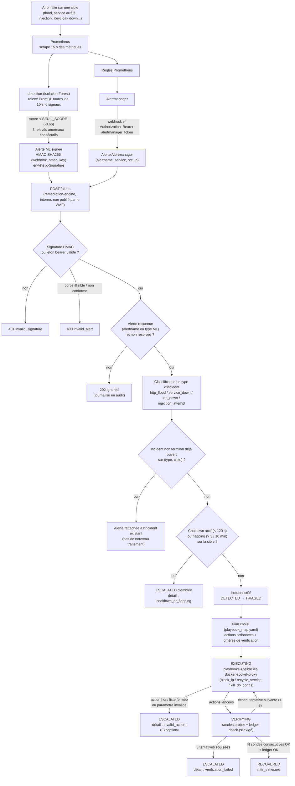

# Schéma — chaîne détection → décision → action

Un diagramme de flux (Mermaid `flowchart`) est le type le plus adapté ici : contrairement au schéma du point 3 (une seule machine à états), cette chaîne traverse plusieurs composants distincts (Prometheus, `detection`, Alertmanager, `remediation-engine`, Ansible, `prober`), avec deux sources d'alerte qui convergent, des points de décision (authentification, reconnaissance, dédoublonnage, cooldown/flapping) et une sortie vers la machine d'états déjà détaillée dans `diagrams/machine-etats-remediation.md`. Un flowchart avec des losanges de décision rend ces embranchements plus lisibles qu'une suite d'états.

Ce schéma est le complément visuel de la section « Vue d'ensemble de la chaîne automatique » et du tableau « Classification des alertes en incidents » de `05-chaine-securite.md`, dont il reprend exactement les valeurs (vérifiées contre le code).

## Diagramme

## Lecture du schéma

- **Deux sources d'alerte convergent sur un seul point d'entrée** (`POST /alerts`) : le modèle ML (`detection`) et les règles Prometheus via Alertmanager. Le moteur les normalise vers un même modèle `{source, type, target, src_ip, score, at}` avant de les traiter de façon identique.
- **Quatre points de décision avant toute action** : authentification de l'alerte, reconnaissance de l'alerte, dédoublonnage par `(type, cible)`, puis garde cooldown/flapping. Une alerte peut donc être acceptée (`202`) sans provoquer la moindre action si elle est rattachée à un incident existant ou si la cible est en cooldown.
- **La partie droite du schéma (à partir de « Incident créé »)** correspond exactement au schéma du point 3 (`diagrams/machine-etats-remediation.md`) : ce diagramme s'arrête où l'autre commence, et la boucle `EXECUTING ↔ VERIFYING` y est reprise à l'identique.
- **Trois issues distinctes en `ESCALATED`**, chacune avec un détail différent (`cooldown_or_flapping`, `invalid_action:…`, `verification_failed`) : c'est ce détail qui oriente le choix du runbook (`RB-05-incident-escalade.md`).
- **Rien dans cette chaîne n'est un accès privilégié de l'assistant documentaire** : le schéma décrit ce que fait automatiquement la plateforme, pas une action que l'opérateur ou l'assistant déclenchent.

## Voir aussi
- `05-chaine-securite.md` — détail de chaque étape (détection, classification, politique de remédiation, actions autorisées, règles de l'orchestrateur).
- `diagrams/machine-etats-remediation.md` — machine d'états détaillée à partir de « Incident créé ».
- `runbooks/RB-10-chaine-remediation-en-panne.md` — diagnostic quand une étape de cette chaîne ne produit pas l'effet attendu.
- `runbooks/RB-05-incident-escalade.md` — reprise manuelle selon le détail de l'escalade.
