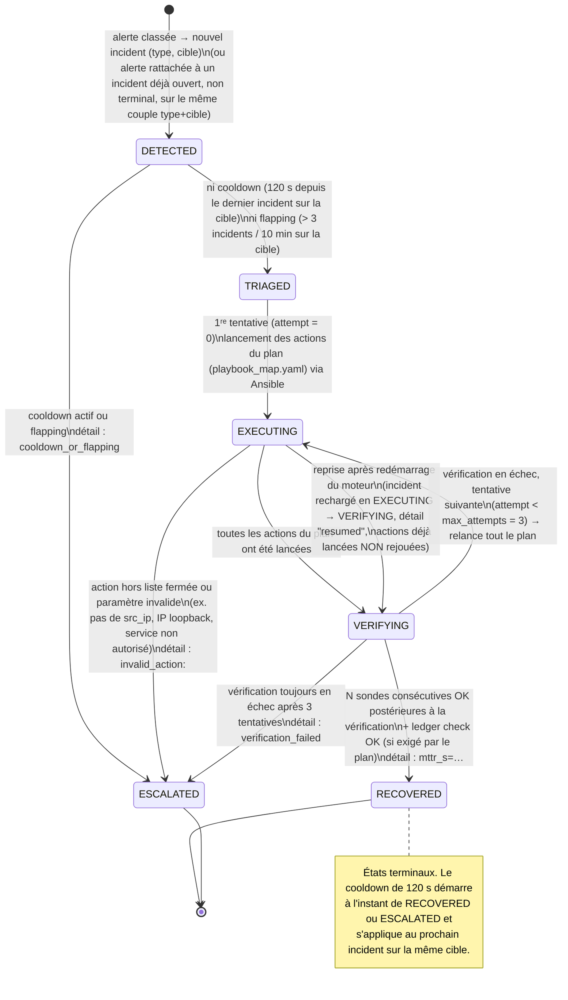

# Schéma — machine d'états d'un incident (remediation-engine)

Un diagramme d'états (Mermaid `stateDiagram-v2`) est le type le plus adapté ici : le moteur ne connaît que six états nommés, les transitions autorisées sont une liste fermée (`core/state_machine.py::TRANSITIONS`), toute autre transition lève une exception, et deux états sont terminaux. C'est le schéma le plus consulté pendant un incident réel ; la version texte équivalente (tableau des transitions) est dans `05-chaine-securite.md`.

## Diagramme

## Lecture du schéma

- **États non terminaux** : `DETECTED`, `TRIAGED`, `EXECUTING`, `VERIFYING`. **États terminaux** : `RECOVERED`, `ESCALATED` — après l'un des deux, l'incident ne change plus d'état.
- **Boucle de retry** : `EXECUTING ↔ VERIFYING` est la seule boucle du schéma. Chaque passage par `EXECUTING` relance **tout le plan** (toutes les actions, pas seulement celle qui aurait échoué), jusqu'à 3 tentatives au total (`attempt` 0, 1, 2).
- **Les seules sorties d'un état non terminal sont `ESCALATED` ou l'état suivant de la chaîne** : il n'y a pas de transition qui revienne à `DETECTED` ou `TRIAGED` une fois l'exécution commencée.
- **Dédoublonnage en amont de ce schéma** : une alerte qui correspond à un incident déjà ouvert (même type, même cible, état non terminal) ne crée pas une nouvelle instance de la machine — elle est rattachée à l'incident existant.
- **Sérialisation** : un verrou par cible garantit qu'une seule instance de cette machine tourne à la fois pour une cible donnée.
- Toute transition absente du diagramme (par exemple `DETECTED → EXECUTING` ou `RECOVERED → DETECTED`) lève une erreur `IllegalTransition` et ne peut pas se produire en fonctionnement normal.

## Voir aussi
- `05-chaine-securite.md` — tableau des transitions, politique de remédiation, actions autorisées, règles de l'orchestrateur (cooldown, anti-flapping, dédoublonnage, reprise après crash).
- `runbooks/RB-05-incident-escalade.md` — que faire face à un incident `ESCALATED`, selon le détail de la transition (`cooldown_or_flapping`, `invalid_action:…`, `verification_failed`).
- `runbooks/RB-10-chaine-remediation-en-panne.md` — diagnostic quand aucun incident ne se crée ou ne progresse.
